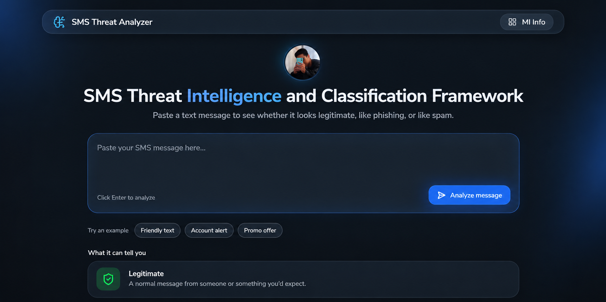
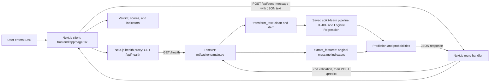

# ScamLens — SMS Threat Classification Framework

**Deployed application:** [https://ml-mini-project-2-nextjs.vercel.app](https://ml-mini-project-2-nextjs.vercel.app)  
**Architecture diagram:** [https://excalidraw.com/#json=z85JnmCwfNKHz9fZFp6gA,irGF1_pTKc8TR_eIvYgSaQ](https://excalidraw.com/#json=z85JnmCwfNKHz9fZFp6gA,irGF1_pTKc8TR_eIvYgSaQ)  
**Repository:** [https://github.com/dev0302/Machine-Learning-Driven-SMS-Threat-Classification-Framework-ml-miniproject-2](https://github.com/dev0302/Machine-Learning-Driven-SMS-Threat-Classification-Framework-ml-miniproject-2)



ScamLens is a full-stack SMS classification project. A user submits a message in a Next.js web app, the Next.js server validates it and calls a separate FastAPI service, and the FastAPI service preprocesses the text and passes it to a saved scikit-learn pipeline. The result classifies the message as **ham** (legitimate), **smishing** (SMS phishing), or **spam**, with class probabilities and descriptive message indicators.

> A model prediction is an estimate, not a safety guarantee. A message classified as ham can still be malicious; always verify suspicious links, payment demands, and requests for personal information independently.

## Contents

- [Features](#features)
- [System architecture and request flow](#system-architecture-and-request-flow)
- [Repository layout](#repository-layout)
- [Run the project locally](#run-the-project-locally)
- [Frontend and backend connection](#frontend-and-backend-connection)
- [API reference](#api-reference)
- [How the ML folder works](#how-the-ml-folder-works)
- [How the frontend works](#how-the-frontend-works)
- [Tech stack](#tech-stack)
- [Deployment notes](#deployment-notes)

## Features

- Classifies SMS text into ham, smishing, or spam.
- Displays the predicted label, confidence, per-class probabilities, and message measurements.
- Identifies visible indicators such as URLs, email addresses, phone numbers, and currency symbols.
- Includes a health endpoint and frontend polling/retry behavior to accommodate a sleeping or starting inference service.
- Includes a notebook for dataset exploration, model comparison, evaluation, and pipeline export.
- Includes an ML information page at `/ml-info` describing training and inference.

## System architecture and request flow



The important boundary is between the browser and the ML service: the browser calls **same-origin Next.js routes**, not FastAPI directly. This keeps the ML service URL in the Next.js server environment and avoids requiring browser-side CORS access for normal application requests.

### Prediction lifecycle

1. The user enters an SMS on the home page. The UI blocks empty input and offers a few example messages.
2. The frontend checks `/api/health`. Before sending a prediction, it polls while the backend is waking up, at roughly two-second intervals, up to 60 seconds. It treats a recent successful check (within 10 minutes) as warm and retries a prediction once if the ML service appears to have gone down.
3. The browser sends `{ "text": "..." }` to the Next.js `POST /api/send-message` route.
4. The route validates and trims the string with Zod (1–5,000 characters). Invalid input returns HTTP 400 without calling the ML service.
5. The Next.js server sends the validated text to `ML_API_URL + /predict`. The FastAPI Pydantic model accepts 1–10,000 characters; the frontend's 5,000-character limit is stricter.
6. FastAPI loads `ml/models/scamlens_model.pkl` once during app startup. It applies the inference preprocessing in `features.py` and passes the cleaned text into the serialized vectorizer/classifier pipeline.
7. The classifier returns a class ID and, when `predict_proba` is available, probabilities for the classes. FastAPI also measures indicators from the original unmodified message.
8. The Next.js route returns the JSON to the browser. The page renders the verdict, confidence, probability bars, and message indicators.

### Architecture image in this repository

The checked-in architecture image can also be viewed here:


## Repository layout

```text
.
├── README.md                         # Project overview and setup guide
├── ml-sms-threat-mini-project-arch.png
├── frontend/                         # Next.js app and same-origin API proxy
│   ├── app/
│   │   ├── (app)/ml-info/page.tsx    # Training/inference explanation page
│   │   ├── api/health/route.tsx      # Proxies health checks to FastAPI
│   │   ├── api/send-message/route.ts # Validates input and calls /predict
│   │   ├── schemas/messageSchema.ts  # Zod input schema
│   │   ├── page.tsx                  # SMS form and prediction UI
│   │   ├── layout.tsx                # Root layout and shared metadata
│   │   └── globals.css               # Global styling
│   ├── components/navbar/            # Navbar components
│   ├── public/                       # Static images and icons
│   ├── package.json                  # Frontend scripts and dependencies
│   └── next.config.ts                # Next.js configuration
└── ml/                               # Dataset, training notebook, model, and API
    ├── main.ipynb                    # Analysis, training, evaluation, export
    ├── data/LSDST-2022.csv           # Dataset used by the notebook
    ├── models/scamlens_model.pkl     # Serialized fitted inference pipeline
    ├── backend/
    │   ├── main.py                   # FastAPI app and prediction endpoints
    │   ├── features.py               # Text preprocessing and indicators
    │   └── requirements.txt          # Python API dependencies
    └── README.md                     # ML-specific notes
```

## Run the project locally

Run the ML API and frontend in **two separate terminals**. Start the API first so the model is ready when the frontend checks health.

### Requirements

- Python 3 and `pip`
- Node.js and npm
- The checked-in model file at `ml/models/scamlens_model.pkl`
- The dataset at `ml/data/LSDST-2022.csv` only if you want to run the training notebook; it is not needed for inference when the model artifact is present

### 1. Install and start the ML API

From the repository root, create and activate a virtual environment:

**Windows PowerShell:**

```powershell
py -m venv .venv
.\.venv\Scripts\Activate.ps1
```

**macOS/Linux:**

```bash
python3 -m venv .venv
source .venv/bin/activate
```

Install the API dependencies and run FastAPI from its backend directory:

```bash
python -m pip install --upgrade pip
python -m pip install -r ml/backend/requirements.txt
cd ml/backend
python -m nltk.downloader stopwords punkt punkt_tab
python -m uvicorn main:app --reload --host 127.0.0.1 --port 8000
```

The API is available at `http://127.0.0.1:8000`. FastAPI's interactive docs are at `http://127.0.0.1:8000/docs` and its OpenAPI schema is at `http://127.0.0.1:8000/openapi.json`.

The model is loaded at startup. If the model artifact is missing, startup fails with an instruction to run the notebook's model-saving cell. The preprocessing code can download NLTK stopwords on first use as a fallback; pre-downloading NLTK data above avoids that first-request work.

### 2. Install and start the Next.js frontend

Open a second terminal at the repository root:

```bash
cd frontend
npm ci
```

Create `frontend/.env.local` with the local FastAPI origin:

```dotenv
ML_API_URL=http://127.0.0.1:8000
```

Then start the development server:

```bash
npm run dev
```

Open [http://localhost:3000](http://localhost:3000). The app's health proxy and prediction proxy read `ML_API_URL` on the Next.js server, so restart `npm run dev` after changing `.env.local`.

### Frontend commands

Run these from `frontend/`:

| Command | Purpose |
|---|---|
| `npm ci` | Install the exact dependencies recorded in `package-lock.json`. |
| `npm run dev` | Start the local Next.js development server. |
| `npm run build` | Create a production build. |
| `npm start` | Serve the production build; run `npm run build` first. |
| `npm run lint` | Run ESLint. |

## Frontend and backend connection

Set the frontend environment variable `ML_API_URL` to the **origin** of the FastAPI service, without an endpoint suffix. The route handlers append `/health` and `/predict` themselves.

| Frontend route | Upstream FastAPI call | Purpose |
|---|---|---|
| `GET /api/health` | `GET {ML_API_URL}/health` | Health proxy used by the page to check/wake the service. Returns `{ "status": "ok" }` when reachable; returns HTTP 503 with `{ "status": "waking" }` on timeout or upstream 5xx. |
| `POST /api/send-message` | `POST {ML_API_URL}/predict` | Validates the browser body with Zod, forwards its `text`, then returns the ML response. |

These are Next.js **route handlers**, not browser-to-ML calls. In production, set `ML_API_URL` in the frontend hosting provider's server-side environment variables to the deployed FastAPI origin. It should not use a `NEXT_PUBLIC_` prefix. The API's current CORS allowlist contains local origins (`localhost:3000` and `127.0.0.1:3000`); CORS is not involved in the Next.js server-to-server request path described above.

## API reference

### FastAPI service

Base URL for local development: `http://127.0.0.1:8000`.

| Method | Endpoint | Request | Success response | Purpose |
|---|---|---|---|---|
| `GET` | `/health` | None | `{"status":"ok","model_loaded":true}` | Reports that the API is running and whether its model is loaded. |
| `POST` | `/predict` | JSON object with `text` (1–10,000 characters) | Prediction JSON (shape below) | Preprocesses and classifies one message. |

#### `POST /predict`

Example request:

```json
{
  "text": "Congratulations! You have won a prize. Claim now at https://example.com"
}
```

Example response shape:

```json
{
  "label": "smishing",
  "class_id": 1,
  "confidence": 0.91,
  "probabilities": {
    "ham": 0.02,
    "smishing": 0.91,
    "spam": 0.07
  },
  "features": {
    "char_count": 78,
    "word_count": 11,
    "digit_count": 0,
    "uppercase_count": 1,
    "special_char_count": 8,
    "exclamation_count": 1,
    "question_count": 0,
    "url_count": 1,
    "has_url": 1,
    "has_email": 0,
    "has_phone": 0,
    "has_money_symbol": 0
  }
}
```

The numeric values above illustrate the response structure; actual output depends on the supplied message and the loaded model. `confidence` is the highest predicted class probability when the model supports `predict_proba`; otherwise it is `null`. `probabilities` is similarly `null` if unavailable. The saved pipeline currently uses Logistic Regression and returns probabilities.

Label IDs follow the notebook's label encoding: `0 = ham`, `1 = smishing`, `2 = spam`.

#### Validation and errors

- FastAPI expects a JSON object with a nonempty string `text` of at most 10,000 characters. Pydantic rejects missing, wrong-type, too-short, or too-long values with HTTP 422.
- Whitespace-only text is rejected with HTTP 422 and `{"detail":"Message text cannot be blank."}`.
- If the model is unavailable during a prediction, FastAPI responds HTTP 503. Ordinarily, a missing model prevents app startup because it is checked during lifespan initialization.
- A prediction-processing failure or unknown class returns HTTP 500 with a descriptive `detail`.
- The Next.js route accepts 1–5,000 trimmed characters. Zod errors return HTTP 400 as `{ "error": "..." }`.
- If FastAPI returns a non-success response, the Next.js prediction route returns HTTP 502 as `{ "error": "Failed to analyze the message.", "details": ... }`. Unexpected route failures return HTTP 500.

### Next.js same-origin endpoints

| Method | Endpoint | Input | Purpose |
|---|---|---|---|
| `GET` | `/api/health` | None | Checks FastAPI health through the server-side `ML_API_URL`. The upstream call has an 8-second timeout. |
| `POST` | `/api/send-message` | `{ "text": "..." }` | Validates text, forwards it to FastAPI, and returns the prediction payload. |

Quick local check after both services are running:

```bash
curl http://127.0.0.1:8000/health
curl -X POST http://127.0.0.1:8000/predict \
  -H "Content-Type: application/json" \
  -d '{"text":"Your account is locked. Verify now at https://example.com"}'
```

## How the ML folder works

The `ml/` folder has two related but distinct jobs: **offline training** in the notebook and **online inference** in the FastAPI backend. Starting the web app only needs the already-exported model artifact; training is not performed when a request arrives.

### Training and model export

`ml/main.ipynb` documents the model-building process. Its described workflow is:

1. Read `ml/data/LSDST-2022.csv` into a DataFrame.
2. Normalize the dataset columns and labels, inspect missing/duplicate/conflicting rows, and encode the target labels.
3. Explore class balance and message patterns such as message length, URLs, digits, uppercase characters, and suspicious vocabulary.
4. Create cleaned message text using lowercasing, placeholder tokens for URLs, money, phone numbers, and numbers, tokenization, stop-word filtering, and stemming.
5. Split into stratified train/test sets (80:20, random state 42) so class proportions are maintained.
6. Fit TF-IDF on training text (up to 3,000 features), then compare candidate classifiers using stratified cross-validation and class-aware metrics.
7. Evaluate selected models on held-out data with classification metrics and a confusion matrix.
8. Serialize the fitted TF-IDF + Logistic Regression pipeline to `ml/models/scamlens_model.pkl` for inference.

The dataset file is checked into this repository. To reproduce the model, open `ml/main.ipynb` in Jupyter and run its cells in order with the notebook's working directory set to `ml/` (the notebook uses paths relative to that folder). The notebook is the source of truth for the exact training code and measured metrics.

### Inference service internals

- `ml/backend/main.py` defines the FastAPI app, request/response models, startup model loading, health check, and prediction handler.
- `ml/backend/features.py` contains the preprocessing shared with the model workflow and computes human-readable message measurements.
- `ml/models/scamlens_model.pkl` is a fitted scikit-learn pipeline, loaded once at app startup. It combines TF-IDF feature conversion with the trained classifier.
- `ml/backend/requirements.txt` lists FastAPI, Uvicorn, scikit-learn, NLTK, and Pydantic.

For each prediction, `transform_text()` lowercases the original text, replaces URL/money/phone/number patterns with `urltoken`, `moneytoken`, `phonetoken`, and `numtoken`, tokenizes, removes non-alphanumeric tokens and English stopwords (while retaining a small list of important words), then applies Porter stemming. The saved TF-IDF transformer maps that cleaned text to its learned feature space before the classifier predicts.

Separately, `extract_features()` measures counts and flags from the **original** message: character and word counts, digits, uppercase and special characters, exclamation and question marks, URLs, email, phone, and currency symbols. These values are included for the interface; the current classifier uses the cleaned text and TF-IDF pipeline, not these indicators as model inputs.

The API and notebook must keep their text preprocessing aligned. If training preprocessing changes, update the inference preprocessing to match and regenerate the saved artifact.

## How the frontend works

- `frontend/app/page.tsx` is the interactive home page: message input, examples, pending/wake states, result display, probability bars, and message measurements.
- Before prediction, the page checks backend availability using `GET /api/health`. It gives a slow service time to wake up and retries the prediction once after a connection/server failure.
- On submit, the page posts the text to `/api/send-message` using Axios. It displays the result and offers an action to clear the form and analyze another message.
- `frontend/app/api/send-message/route.ts` is a server-side proxy. It applies `messageSchema`, sends the accepted value to `${ML_API_URL}/predict`, and passes the JSON response back to the browser.
- `frontend/app/api/health/route.tsx` proxies the FastAPI health route with an 8-second timeout and reports `ok` or `waking` to the page.
- `frontend/app/schemas/messageSchema.ts` trims input and enforces the UI-facing range of 1–5,000 characters.
- `frontend/app/(app)/ml-info/page.tsx` presents the training pipeline, prediction lifecycle, and implementation notes.
- `frontend/app/layout.tsx`, `globals.css`, and `animations.css` provide shared layout, metadata, and styling; `components/navbar/` contains navbar components.

## Tech stack

| Area | Technologies |
|---|---|
| Frontend | Next.js 16, React 19, TypeScript |
| Styling and UI | Tailwind CSS 4, Lucide React, Sonner |
| Frontend data and validation | Axios, Zod |
| ML API | Python, FastAPI, Uvicorn, Pydantic |
| NLP and model | NLTK, scikit-learn, TF-IDF, Logistic Regression |
| Model artifact | Python pickle serialization |
| Deployment | Vercel frontend; FastAPI service deployed separately and configured by `ML_API_URL` |

## Deployment notes

- The deployed frontend URL is listed at the top of this README. The ML API is a separate service; the frontend deployment must have `ML_API_URL` configured to its reachable base URL.
- Set `ML_API_URL` as a server-side environment variable in the frontend deployment settings, then redeploy/restart the frontend after changing it.
- The API service must include the Python dependencies and the `ml/models/scamlens_model.pkl` artifact at the expected repository-relative path.
- `ml/backend/main.py` currently permits local frontend origins in its CORS configuration. Since the provided Next.js handlers call FastAPI server-to-server, production browser requests to the app use same-origin routes; add production origins only if browser code is later changed to call FastAPI directly.
- A sleeping or cold-starting API may delay the first analysis. The UI polls for up to one minute before displaying a timeout message.

## Limitations

- Results reflect the training data and the text model; they are not proof that a message is safe or dangerous.
- `confidence` and the class probabilities are model estimates and may not be calibrated probabilities.
- Message indicators describe surface traits; they do not explain which tokens caused the classifier's decision.
- The API deserializes a pickle model. Only use a trusted model file generated for this project.
